# Multi-Cloud Identity: Microsoft Entra ID SSO and SCIM Provisioning to AWS IAM Identity Center

**Status:** ✅ Built and tested

## Video Walkthrough

> 🎥 Loom walkthrough coming soon

## Project Overview

Most companies don't run on one cloud. Engineers sign in to Microsoft 365 with their Entra ID account, then need access to AWS too. If AWS has its own separate users, every joiner gets a second account created by hand, every mover keeps old permissions, and every leaver has to be remembered in two places. The AWS account a terminated engineer still has is exactly the kind of access an audit finds.

In this lab I made Microsoft Entra ID the single identity provider for AWS. Users sign in to AWS through Entra ID with **SAML 2.0**, so there's no AWS password at all. **SCIM** provisioning creates, updates, and removes their AWS identities automatically, scoped to two Entra groups. AWS access is defined as permission sets in Terraform and granted only to those synced groups, never to individual users. Joiner, mover, and leaver all happen in one place: group membership in Entra ID.

### Skills Demonstrated

- **SAML 2.0 federation** between Microsoft Entra ID (identity provider) and AWS IAM Identity Center (service provider)
- **SCIM 2.0 provisioning** of users and groups from Entra ID to AWS
- **Scoped provisioning**: only assigned groups exist in AWS
- **Multi-cloud identity governance** with Entra ID as the single source of truth
- **AWS Organizations** and **IAM Identity Center** setup
- **Least-privilege permission sets** with different session lengths for read-only and admin access
- **Group-based access** for joiner, mover, and leaver
- **Terraform** across two providers: `azuread` for Entra users and groups, `aws` for permission sets and assignments
- Terraform authenticates through the Azure CLI and AWS CLI sessions, so no client secrets or access keys are stored in the repo

## Architecture Diagram

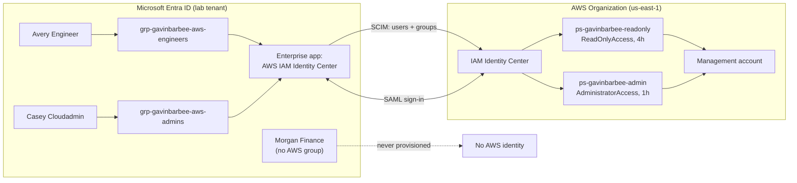

## Prerequisites

- An Entra ID lab tenant I control, with a Global Administrator account and an Entra ID P1 or P2 license (needed for SCIM provisioning to gallery apps)
- A personal AWS account I control, used as an AWS Organizations management account
- Windows + VS Code + PowerShell
- Azure CLI, AWS CLI, and Terraform installed

## Naming Conventions

| Object | Name |
| --- | --- |
| Entra users | `gavinbarbee-awseng` (Avery Engineer), `gavinbarbee-awsadmin` (Casey Cloudadmin), `gavinbarbee-awsnoaccess` (Morgan Finance) |
| Entra groups | `grp-gavinbarbee-aws-engineers`, `grp-gavinbarbee-aws-admins` |
| Entra enterprise app | `app-gavinbarbee-aws-identity-center` |
| IAM Identity Center region | `us-east-1` |
| Permission sets | `ps-gavinbarbee-readonly`, `ps-gavinbarbee-admin` |

## Project Steps

### 1. Create the AWS Organization and enable IAM Identity Center

My AWS account was standalone, so I created an organization from the AWS Organizations console, which made it the management account. Then, in `us-east-1`, I enabled **IAM Identity Center** with AWS Organizations. The organization instance is the one that can grant access to AWS accounts; an account instance can't. Identity Center lives in one region, so I chose it before enabling.

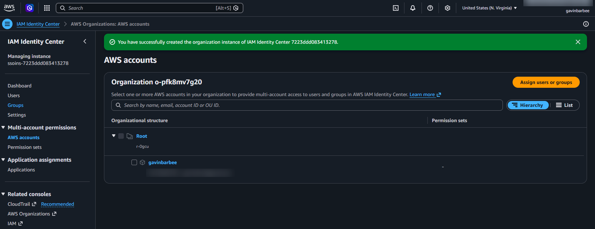

### 2. Create the Entra users and groups with Terraform

Terraform authenticates with my Azure CLI session, so no app registration or client secret is needed:

```powershell
az login --tenant gavinbarbeeyahoo.onmicrosoft.com --allow-no-subscriptions
cd terraform\entra
terraform init
terraform plan "-out=main.tfplan"
terraform apply main.tfplan
```

This creates three users and two groups. Avery is in the engineers group, Casey is in the admins group, and Morgan is in neither, so Morgan is the control that proves scoping works. AWS requires a first name, last name, and display name on every provisioned user, so the Terraform sets all three.

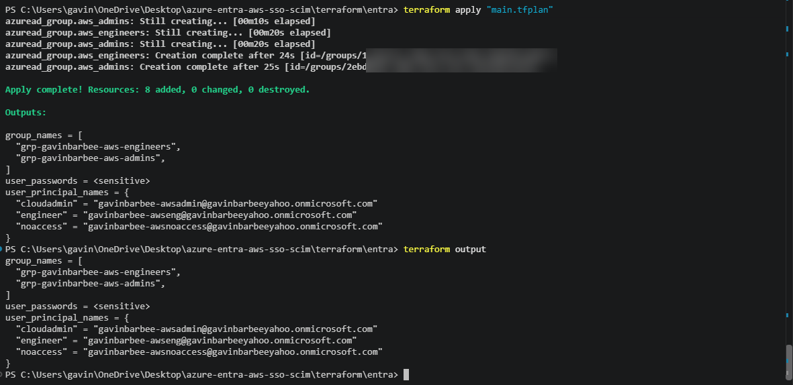

### 3. Federate Entra ID and AWS with SAML

In the Entra admin center I added **AWS IAM Identity Center** from the enterprise app gallery and renamed it `app-gavinbarbee-aws-identity-center`.

SAML trust is a two-way metadata exchange:

1. In AWS, IAM Identity Center → Settings → **Change identity source** → **External identity provider**. AWS shows its service provider details: the **ACS URL** and **issuer URL**.
2. In the Entra app, under **Single sign-on → SAML**, I entered those as the **Reply URL** and **Identifier**, added the **AWS access portal URL** as the **Sign on URL**, then downloaded the **Federation Metadata XML**.
3. Back in AWS, I uploaded that XML as the IdP metadata and confirmed the change.

From then on, AWS doesn't hold passwords. It trusts signed SAML assertions from Entra ID.

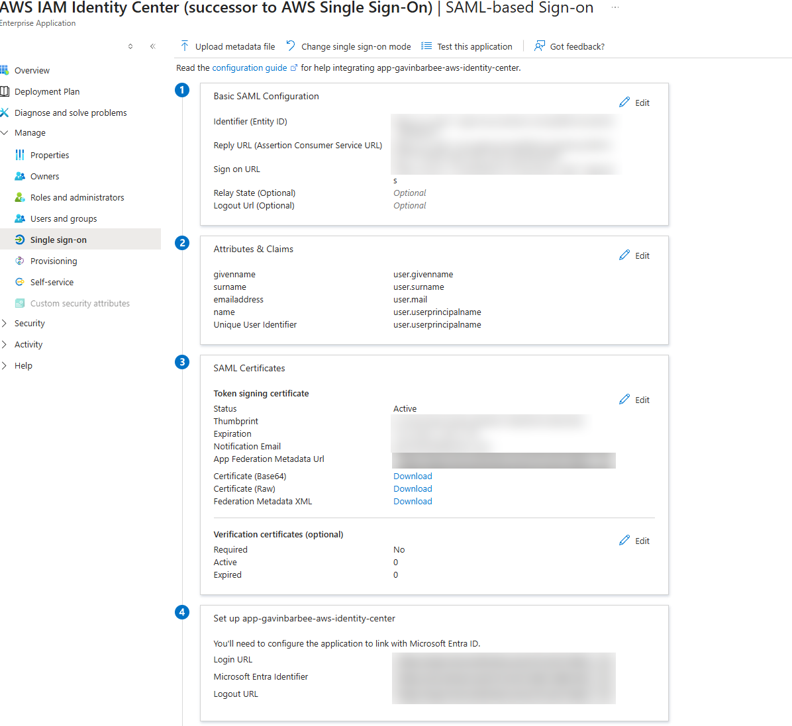
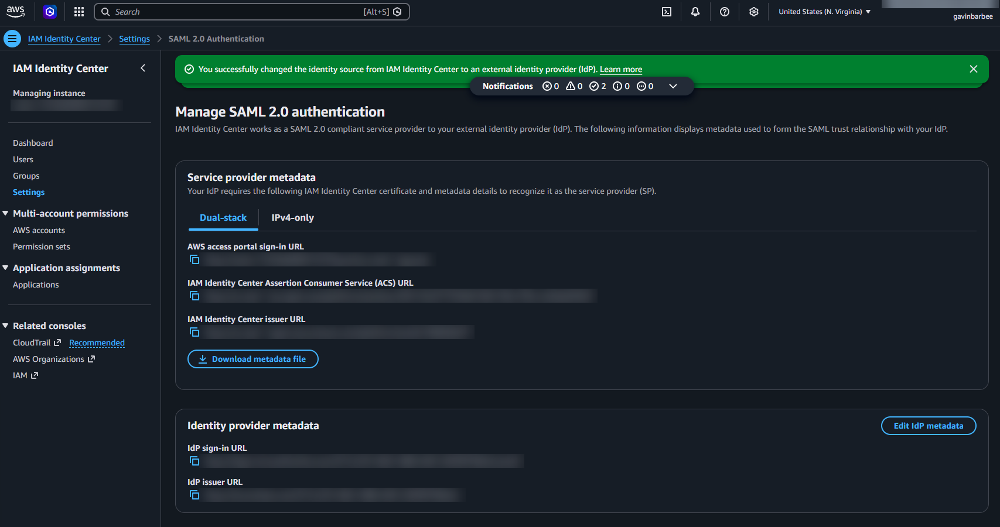

### 4. Turn on SCIM provisioning

In AWS IAM Identity Center → Settings, I enabled **automatic provisioning**. AWS returned a **SCIM endpoint** and an **access token**. The token is shown once, is valid for one year, and is a credential, so it went straight into Entra and nowhere else.

In the Entra app, under **Provisioning**, I set the mode to **Automatic**, pasted the tenant URL and secret token, tested the connection, and set the scope to **Sync only assigned users and groups**. Then I assigned only the two AWS groups to the app.

Instead of waiting for the first provisioning cycle, I used **Provision on demand** on each group with its member selected, which created the group, the user, and the membership in AWS in one run. Then I turned provisioning on so later changes flow automatically.

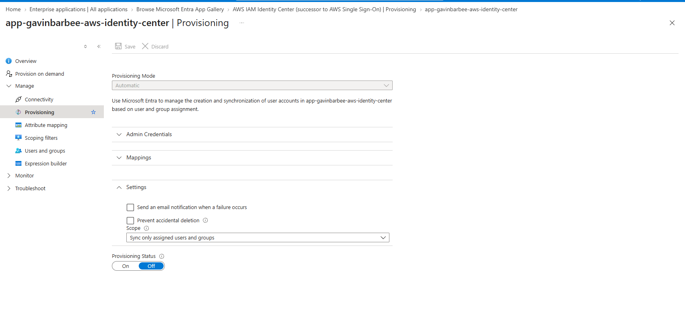
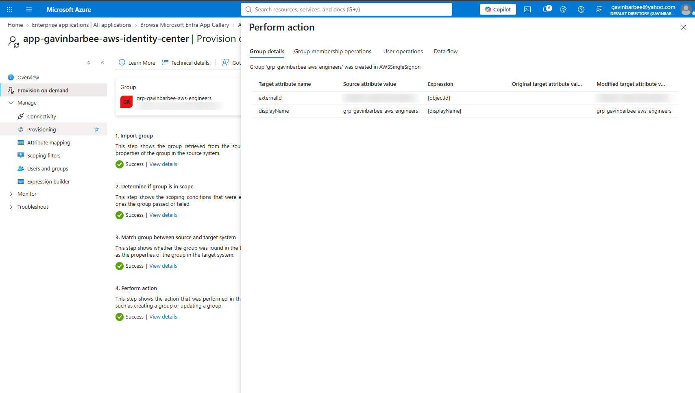

### 5. Grant AWS access with Terraform permission sets

With the groups now in AWS, Terraform looks them up by name and grants access. It doesn't create users or groups in AWS; SCIM owns those, and Entra stays the source of truth. The IAM user my AWS CLI uses needed IAM Identity Center permissions for this step, which I granted only for the deployment (see Troubleshooting).

```powershell
cd terraform\aws
aws sts get-caller-identity
terraform init
terraform plan "-out=main.tfplan"
terraform apply main.tfplan
```

| Group | Permission set | AWS managed policy | Session |
| --- | --- | --- | --- |
| `grp-gavinbarbee-aws-engineers` | `ps-gavinbarbee-readonly` | `ReadOnlyAccess` | 4 hours |
| `grp-gavinbarbee-aws-admins` | `ps-gavinbarbee-admin` | `AdministratorAccess` | 1 hour |

The admin session is deliberately short, so a stolen admin session expires quickly.

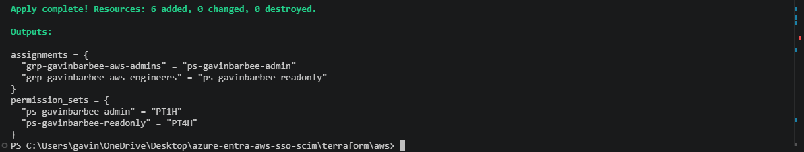
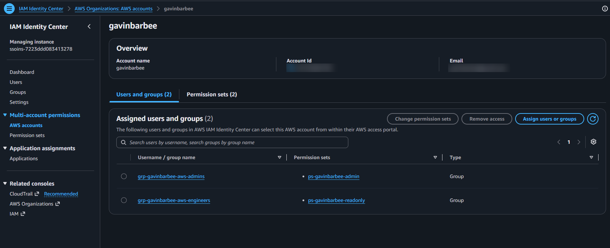

### 6. Sign in to AWS with Entra ID

In a private browser window I signed in to My Apps as Avery, opened the AWS IAM Identity Center tile, and landed in the AWS access portal with only the read-only role available. In the console, I could view resources but creating an S3 bucket was denied.

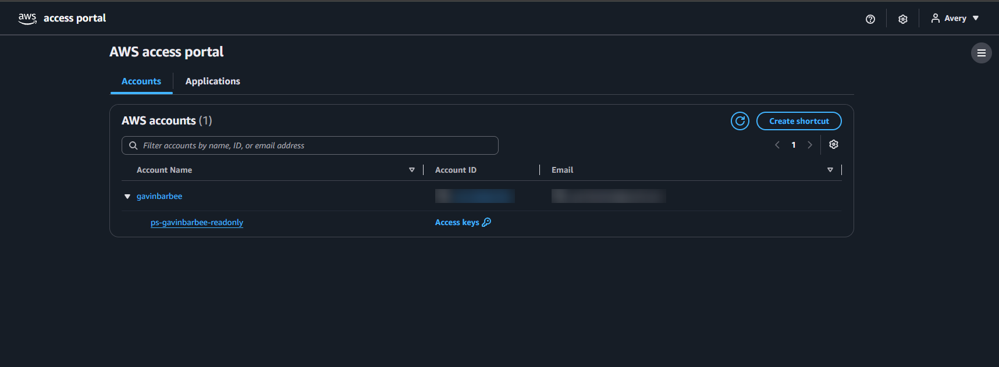
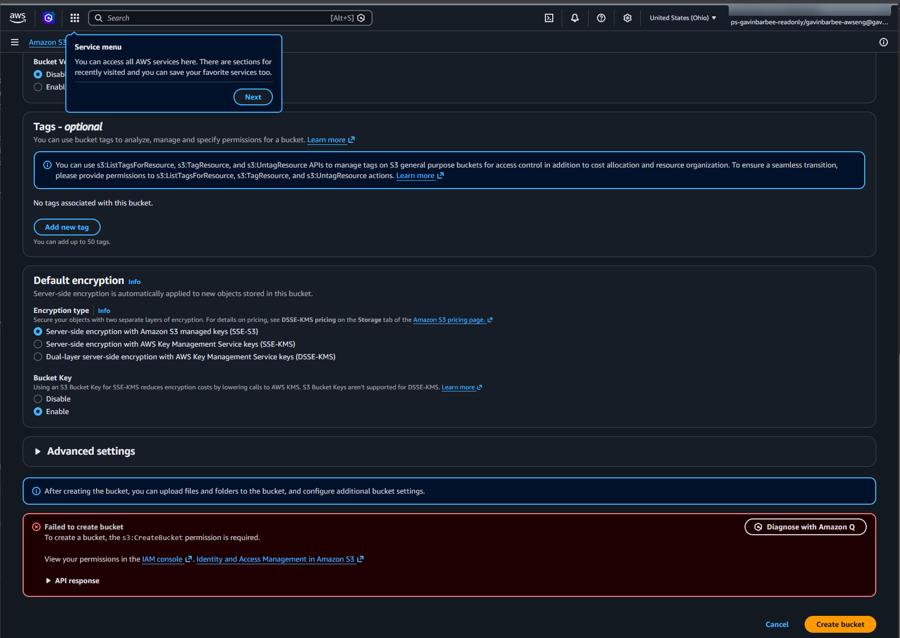

### 7. Verify scoping

In IAM Identity Center → Users, Avery and Casey exist and Morgan doesn't. Morgan has an Entra account but no AWS group, so no AWS identity was ever created.

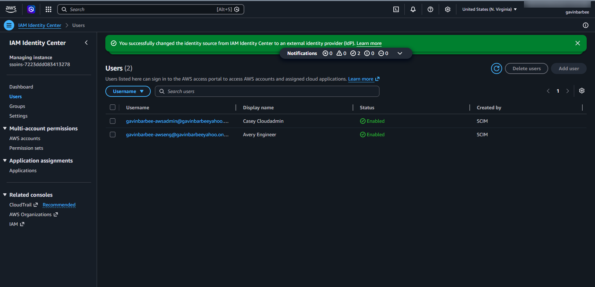

### 8. Leaver test: remove in Entra, gone from AWS

I removed Avery from `grp-gavinbarbee-aws-engineers` in Entra ID. Running Provision on demand on Avery's user object returned `RedundantExport`, because nothing about the user itself had changed: group membership belongs to the group object, so the change travels with the group. When I checked IAM Identity Center afterward, AWS showed Avery as **Disabled**.

Then I checked both sign-in paths as Avery:

- **My Apps:** the AWS tile was gone, because Avery is no longer assigned to the app through any group.
- **The AWS access portal URL directly:** AWS sent Avery to Entra ID to sign in, and Entra ID refused with `AADSTS50105`, because the user isn't assigned to the application.

As a control, I signed in as Casey through the same access portal URL. Casey, still in the admins group, landed in the portal with the admin role.

So the leaver is blocked twice: Entra ID refuses the SAML sign-in, and SCIM disabled the identity in AWS. Either control alone would stop access.

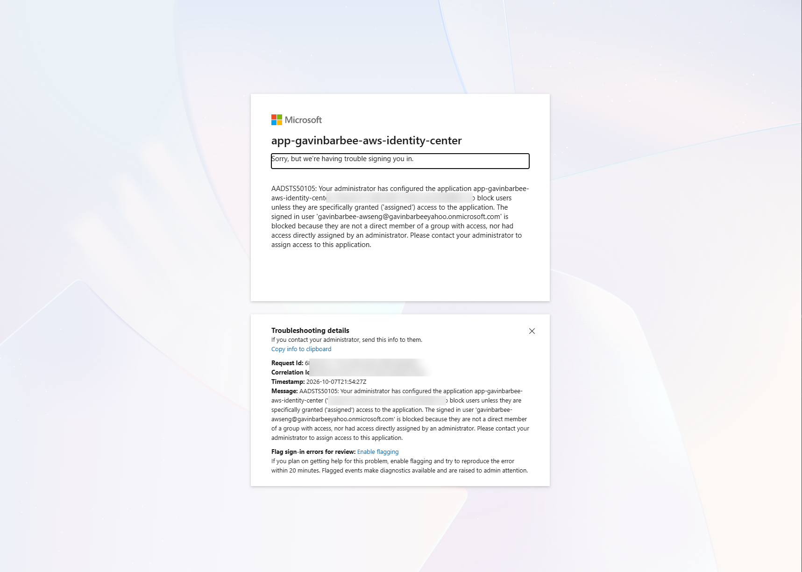

## Verification Checklist

- [x] IAM Identity Center is enabled as an organization instance in `us-east-1`
- [x] The identity source is the Entra ID external identity provider
- [x] SCIM provisioning is scoped to assigned users and groups, with only the two AWS groups assigned
- [x] Avery and Casey exist in Identity Center; Morgan doesn't
- [x] Permissions are assigned to groups, not individual users
- [x] Avery signs in through Entra ID and gets read-only access only
- [x] Removing a user from the Entra group disables them in AWS and blocks their SAML sign-in

## Troubleshooting

| Issue | Cause | Fix |
| --- | --- | --- |
| `terraform plan` in `terraform/aws` failed with `AccessDeniedException: ... is not authorized to perform: sso:ListInstances` | The IAM user my AWS CLI uses was created for an earlier migration lab and had no IAM Identity Center permissions | Attached the AWS managed policy `AWSSSOMasterAccountAdministrator` to that user for the deployment only, ran the plan and apply, then detached the policy so the user went back to its original permissions |
| Going straight to the AWS access portal URL returned `AADSTS50011: The reply URL ... does not match the reply URLs configured for the application` | AWS shows its service provider details on two tabs, **Dual-stack** and **IPv4-only**, and I'd configured the dual-stack ACS URL (`us-east-1.sso.signin.aws`). Signing in from the My Apps tile worked because Entra ID posts to the reply URL I'd configured. Starting from the AWS access portal, AWS sends its own SAML request, and it asked for a different ACS URL (`us-east-1.signin.aws`, without `sso.`) that wasn't in the app's Reply URL list | Added that ACS URL as an additional Reply URL in the Entra app's Basic SAML Configuration, keeping the original as the default. After that, signing in from the access portal reached Entra ID's assignment check, which correctly returned `AADSTS50105` for the removed user |

## Cleanup

Between interview demos, I removed Casey's standing admin access so the lab doesn't leave an admin path into my AWS account, and restore it only when I need to show the admin role.

1. Destroy the AWS permission sets and assignments:

```powershell
cd terraform\aws
terraform destroy
```

2. In Entra ID, stop provisioning and delete the `app-gavinbarbee-aws-identity-center` enterprise app.
3. In IAM Identity Center, change the identity source back to **Identity Center directory** and delete the provisioned users and groups.
4. Destroy the Entra users and groups:

```powershell
cd terraform\entra
terraform destroy
```

## Key Takeaways

- SAML handles **authentication** (who you are at sign-in). SCIM handles **provisioning** (whether you exist in the app at all). A complete integration needs both.
- Entra ID is the single source of truth for AWS access. Joiner, mover, and leaver all happen through group membership in one place.
- Assigning permissions to groups instead of users is what makes the lifecycle automatic.
- The SCIM token is a credential with a one-year expiry. In production it needs an owner, a rotation date, and monitoring, or provisioning silently stops.
- Terraform reads the SCIM-created groups rather than creating them, so there's no conflict over which system owns identity.

---

*Built by Gavin Barbee · [github.com/gavinbarbee](https://github.com/gavinbarbee) · Time to complete: ~2.5 hours*